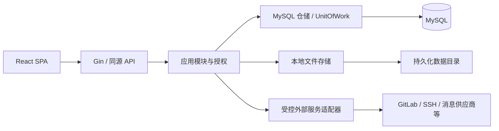

# 架构与模块边界

AntCDP 采用模块化单体：一个 Go 进程、一个 MySQL 数据库、一份本地持久化目录；React SPA 与 API 同源部署。运行状态、开发方法与限制见 [开发指南](development.md)。

## 技术栈与交付

| 层次 | 当前选择 | 边界 |
| --- | --- | --- |
| 后端 | Go、Gin | HTTP 层处理协议和认证上下文，业务规则归所属模块 |
| 存储 | MySQL 8.x、InnoDB、utf8mb4 | 支持 8.0.16 起的 8.x；不承诺 MariaDB 或其他数据库兼容 |
| 数据访问 | database/sql、go-sql-driver/mysql、sqlx | 手写 SQL、显式事务；驱动句柄不进入模块接口 |
| 迁移 | Goose、go:embed | 单一初始基线及后续增量迁移；无 ORM 自动改表 |
| 前端 | React、TypeScript、Vite、React Router | 按功能装配页面，通过同源 `/api/v1` 访问服务 |
| UI | 本地 shadcn/ui、Radix UI、Tailwind CSS | 基础组件和平台组合共享，业务组件归各模块 |
| 身份 | bcrypt、数据库会话、HttpOnly Cookie、CSRF | 不使用 JWT 或 Redis；权限由服务端校验 |
| 文件 | 本地目录与小范围存储接口 | 头像、业务图标、发布文件及临时文件；无对象存储适配 |
| 日志 | log/slog | 结构化运行日志与业务审计分离，不记录秘密 |

依赖版本以 `go.mod/go.sum` 和 `web/package-lock.json` 为准。构建先生成 `web/dist/`，再将 SPA 与 SQL 迁移嵌入二进制；运行容器不包含 Node、Go 工具链或源码。默认构建使用 CGO_ENABLED=0。采用理由见 [技术决策](technology-decisions.md)。

## 运行结构



当前只支持单应用实例。数据库会话不消除进程锁、内存限流、维护循环和本地文件的单实例边界；不同数据卷也不能作为同一安装的多副本方案。

## 实际模块

| 模块 | 职责 |
| --- | --- |
| install | 空库检查、迁移、种子、安装身份、主密钥、完成标记与恢复 |
| identity | 用户、本地密码、会话、系统身份及共享业务授权事务 |
| settings / audit | 受控系统设置与只读审计查询 |
| media | 头像与图标处理所需的文件规范化、存储与回收能力 |
| collaboration | 项目、团队、成员来源、业务角色、图标与快捷方式 |
| integrations | 服务连接、凭证、Webhook、平台适配器与项目仓库关联 |
| remotehosts | 独立 SSH 主机、公钥信任、凭证和诊断 |
| projectdelivery | 分支模型、变体、环境、分支创建、发布与材料生命周期 |
| email / sms / dingtalk | 三套独立配置、模板或测试用例，不合并为消息业务包 |

模块使用稳定用户 ID 关联。系统身份与项目/团队角色独立；团队管理员不会自动成为项目管理员。发布、仓库关联、分支创建和凭证维护各自校验权限及凭证选择规则，不提供通用执行授权链。

## 源码组织

```text
cmd/antcdp/                 # 程序入口
internal/app/              # 生命周期、装配、维护循环
internal/server/           # 路由、中间件、DTO 协议与 SPA 边界
internal/modules/          # 上述业务模块
internal/store/mysql/      # sqlx 仓储、事务适配器与私有行结构
internal/store/migrations/ # 嵌入式 SQL
internal/platform/         # 配置、加密、文件、密码、HTTP 基础设施
web/src/app/               # 外壳、身份上下文、全局导航
web/src/features/          # 业务页面
web/src/components/        # 基础组件与平台组合
web/src/shared/            # API、DTO、纯函数
web/src/styles/            # 语义变量与全局样式入口
scripts/                   # 构建与验证
```

## 依赖与事务

- HTTP Handler → 应用服务 → 领域规则/仓储端口 → MySQL、文件及网络适配器；Handler 不直接处理 SQL 或授权规则。
- 用例通过所属模块的小范围仓储/事务接口协作，适配器绑定同一事务；不建立全站通用 CRUD 或巨型 Repository。
- SQL 使用显式列名、私有行结构和绑定参数；动态字段与排序来自白名单。查询有分页或上限，不使用 Unsafe() 掩盖映射问题。
- 敏感写入在事务内重新验证账号、权限、状态和版本，业务数据与审计原子提交。跨模块锁序及重试由各用例契约规定。
- 网络调用和大文件 IO 不持数据库锁。先记录意图或快照，再执行外部操作，最后按实际结果记账；未知结果不能自动当作失败重发。
- 维护循环处理会话/媒体清理、消息日志与中断状态、分支创建等过期状态，不承担通用工作流调度。过期判断不依赖清理准时执行。

## 身份、文件与安装

用户密码使用 bcrypt，与系统主密钥分离。会话数据库只保存随机令牌的 SHA-256，校验账号状态、auth_version、撤销及过期时间；完整规则见 [身份与权限](domain-model.md)。同源写操作受 CSRF 保护，代理信任由部署配置限定。

32 字节主密钥保存在私有数据目录，通过用途派生和资源绑定 AAD 加密配置及外部秘密；普通 API 不读取秘密。文件先暂存，事务管理元数据和绑定，回收确认没有有效引用。自动密钥轮换、KMS 和对象存储尚未实现。

安装、迁移、种子事务和文件完成标记分步执行；MySQL DDL 不具备整次安装回滚能力。serve 只检查版本和结构，db migrate 是显式维护命令。安装身份及完整数据目录必须与数据库匹配，详见 [部署与维护](deployment.md)。

## 前端与扩展

应用外壳负责全局和项目上下文导航，各业务页面负责自己的请求、状态和权限展示。路由守卫改善体验，不能替代 API 授权。组件定制、错误、未保存保护和 URL 兼容见 [前端文档](frontend.md)，支持范围见 [UI 规范](ui-design.md)。

受控 KV 仅保存低频配置；项目、仓库、凭证和发布等实体拥有独立表。Webhook 只验证接收，审计不是队列。外部登录、其他存储引擎、通用调度、Graph 工作流与 Agent 执行尚未实现；扩展要求见 [扩展边界](extensibility.md)。
