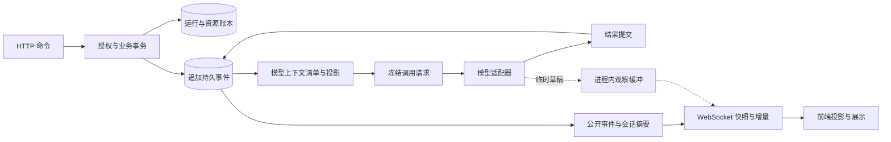

# 助手执行、事件溯源与通讯

本文维护跨组件设计及正确性约束。事件载荷、工具参数、状态枚举和协议限额以代码与测试为准；不将实现清单复制为第二套接口定义。

## 事实、状态与投影

助手历史以追加的持久事件表达输入、上下文变化、模型结果、工具意图与结果、终态和文件绑定。运行记录、预算、租约及物理操作账本仍承担并发控制和执行职责，不能仅凭聊天事件重建正在运行的外部活动。

| 层次 | 来源与用途 | 边界 |
| --- | --- | --- |
| 持久事件 | 已提交的历史事实，含公开展示数据与独立原生模型事实 | 对外仅投影获准的公开数据，不直接序列化内部事件封装 |
| 运行与资源账本 | 当前授权、执行占用、预算、物理操作及结算状态 | 由服务事务维护，展示缓存不能改变它们 |
| 模型上下文投影 | 按清单选择持久事实，重建本次模型请求 | 不从聊天气泡、Markdown 或浏览器状态反向构造 |
| 会话展示投影 | 持久公开事件折叠为摘要、消息与过程节点 | 可重建；不授予权限，也不决定执行结算 |
| 临时模型流 | 当前调用的文本、思考及工具参数草稿 | 仅供实时观察，不能当作已提交消息或已执行工具 |

## 事件提交与溯源

会话事件按持久序号追加，携带格式版本和内容摘要。事件、关联业务状态及对应展示检查点在事务中推进；事务提交后，通过提交回执通知观察层读取已提交范围。进程内通知只提示有新事实，不能替代数据库记录或充当可靠执行队列。

读取与回放校验事件完整性及所需顺序。公开事件与原生模型事实可以表达同一次行为的不同内容，不能用展示文本补造缺失的供应商消息。工具调用关联、声明顺序、原生内容和明确保留的部分结果均需保存足以重放的事实。

历史事件的字段值需要兼容当前接口时，在完整性校验后转换公开投影，保留原始事件、校验摘要及模型上下文。

一个工具调用只结算一次工具结果。迟到的远端核实追加新的观察或上下文事实，不覆盖原结果，也不把历史失败悄悄改成成功。审计日志、调试日志与实时流不承担事件事实的职责。

执行器的当前步骤编号用于执行控制，统计使用已结束步骤数。进入下一步或轮次终止时，在同一事务内持久化前一步的结束事实；等待用户回应、审批或工具结果时不提前计数，同一步内模型重试不重复计数。步骤边界由运行锁、状态推进和事件语义键保证唯一，展示投影按顺序回放；逻辑步骤结束不表示沙箱物理进程已经停止。既有终态运行可从运行账本恢复最终步骤总数，不补造缺失的步骤结束时间。统计事件不进入模型上下文，也不改变冻结请求和缓存前缀。

源码：[事件封装与提交](../../internal/modules/agents/events.go)、[宿主持久化端口](../../internal/agentcore/hooks.go)、[应用装配](../../internal/app/agents.go)。

## 模型上下文与调用快照

输入受理、领取执行和后续操作分别验证资格。根轮次保存执行所需的身份、模型、工具和资源上下文；后续配置写入不反向修改本轮事实。模型上下文清单引用具体持久事件，并显式记录上下文修订、压缩、图像卸载和工具输出裁剪。

模型投影是对所选事实的确定性回放。工具结果按调用声明顺序组织，不能使用并发完成顺序；原生消息及供应商字段按协议保留。中断输出只有被明确接纳的部分内容进入后续上下文，未完成工具调用和部分原生签名不能冒充完整成功消息。可观察的失败尝试也不一定参与模型历史。

每次模型调用在外发前冻结请求：会话部分由上下文清单定位，调用快照补齐提示、工具 Schema、参数、模型路由及图像引用等确定性输入，并记录请求摘要。调用快照不保存明文凭据或展开后的图像字节。当前配置和展示状态都不能替代已冻结输入。

普通连接或流中断重试复用冻结请求，由执行循环统一决定；适配器不能隐藏重试。每次尝试独立记录结果、用量与失败事实。若图像引用失效修复等操作改变请求，应重新准备并记录新的调用，不能伪装成原请求的同一次重试。重试也不能重复派发已经提交的工具副作用。

压缩与内容卸载改变后续请求投影，不回写或删除原始事件。图像变体、提供商文件引用与工具输出文件用于减少重复传输；引用必须经过权限、作用域、有效性与完整性校验。保持消息顺序、提示、工具定义及有效文件引用稳定，有助于上下文前缀缓存命中；本地缓存命中不能证明提供商缓存命中，更不能成为丢弃必要上下文的理由。

源码：[上下文加载](../../internal/modules/agents/surface.go)、[纯投影](../../internal/agentcore/surface.go)、[请求准备](../../internal/modules/agents/preparation.go)、[调用冻结与结算](../../internal/modules/agents/attempts.go)、[执行循环](../../internal/agentadapters/eino/engine.go)。

## 展示投影

服务端会话摘要记录投影版本、覆盖到的事件序号和完整性摘要；缓存失效时从持久事件重建。前端另将公开历史折叠为对话节点，叠加当前临时流与本地交互状态。两者服务于不同展示粒度，都不参与模型上下文重建。

首屏快照中的历史是有界窗口，不能以“当前加载的消息”推断全部历史、总次数或执行状态。摘要、历史窗口和后续增量必须对应明确的持久基线；翻页只补充历史，不倒退实时进度。折叠、排序呈现、复制内容和乐观发送只是视图行为，不能修改事件或模型输入。

源码：[服务端摘要与检查点](../../internal/modules/agents/conversation_projection.go)、[观察快照](../../internal/modules/agents/observations.go)、[前端对话投影](../../web/src/features/agents/data/conversation-projection.ts)。

## 前后端命令与观察

HTTP 承担输入、取消、交互回应等命令及历史查询；WebSocket 承担执行观察。提交成功表示命令已受理，不表示模型或工具已经完成。观察连接建立、断开、重连或切换页面都不启动、重放或取消执行。

写命令按各自接口携带条件版本与幂等标识。响应丢失后保留不确定状态，查询回执或对象核实；回执暂未找到不能推出“未执行”。允许重试时遵守原命令的幂等契约，不能换新标识重新提交同一副作用。本地发送占位通过受理结果和后续事件关联，不能直接升级成持久消息。

观察连接校验会话身份和同源来源，每个会话订阅另行鉴权，后续观察仍检查访问资格。客户端运行状态按登录用户隔离；旧账号、旧连接和旧订阅的迟到响应不能污染当前会话。访问撤销时清除相应内容，认证失效时结束观察并交回身份流程。

每个已登录的客户端运行实例持有一条共享观察连接。页面切换只改变具体会话的正文订阅，不结束全局会话通知订阅；退出登录或运行实例销毁时关闭连接。全局通知是事务提交后的失效提示，逐用户校验访问权限，个人查看位置与置顶变化仅通知本人。通知不携带正文，不替代持久事件；首次订阅、重连及通知缓冲溢出后重新读取列表投影，连续通知合并刷新，并与分页请求串行协调。

源码：[命令状态与回执核实](../../web/src/features/agents/data/command-store.ts)、[发送流程](../../web/src/features/agents/data/send-flow.ts)、[用户级运行状态](../../web/src/features/agents/data/runtime-context.tsx)、[WebSocket 服务端](../../internal/server/agents_stream.go)。

## 快照、双序号与重同步

观察使用两个不同的连续序列：持久事件序号描述已提交历史；运行代次与临时流修订号描述进程内草稿，另用调用标识和片段索引约束一次生成。持久事件序号、上下文修订、对象版本和流游标各有作用，不能互换。

1. 服务端先注册观察缓冲，再读取持久快照，形成带历史覆盖范围和活动草稿的基线，覆盖订阅与读库之间的并发窗口。
2. 提交通知到达后，从数据库补读连续的公开事件；重复事件可以忽略，缺口不能跳过。实时草稿还需匹配运行代次、调用标识及连续片段索引。
3. 草稿结束若指向已提交事件，服务端先补齐持久记录再发送结束通知。客户端以持久记录接替草稿；被放弃的草稿不能成为最终回复。
4. 持久或临时序列缺口、缓冲溢出及运行代次变化要求重同步，暂停应用不可靠增量并重新获取基线；不能继续拼接看似完整的内容。未知协议结构也不能被静默接纳。
5. 重连重新订阅并取得快照。旧历史请求还要匹配订阅与快照代次，避免重同步前发起的分页响应覆盖新状态。

进程内 Hub 是有界观察缓冲，不保存可靠历史。进程重启后可以恢复持久事件，但不能承诺找回未落盘的逐片段输出；执行中断与物理操作恢复由后端账本处理，客户端通过新快照观察结果。

源码：[流模型与 Hub](../../internal/agentcore/streams.go)、[服务端快照与补读](../../internal/server/agents_stream.go)、[客户端连接管理](../../web/src/features/agents/data/stream-client.ts)、[客户端序列校验与归并](../../web/src/features/agents/data/stream-reducer.ts)。

## 外部活动与恢复

模型输出结束、轮次逻辑结束、物理活动结束和资源结算分别记录。取消被接受不等于远端进程退出；租约到期也不能证明工作空间已闲置。未知操作保留意图、归属、代次与占用，恢复依靠可验证观察，不通过再次调用来猜测结果。

数据库、平台文件和沙箱没有分布式事务。复制、绑定、发布及清理分别验证权限、引用、大小和摘要。无操作句柄的原生文件写入超时后不能自动重放，需按后端能力核实或在原实例终止得到确认后释放占用。平台路径校验不能替代后端隔离，也不提供文件 API 本身没有的原子条件写入。

基础沙箱持有物理实例与执行身份；云电脑重建可切换当前实例，但旧命令、租约和操作仍指向原实例。创建或重建入队时，云电脑冻结规格 ID、运行版本、环境和网络预设。重试沿用快照，暂停和恢复沿用原实例。内容生命周期与执行生命周期分开，会话结束不能隐式删除正式成果。

## 核心验证

变更这些设计时，应验证事件回放与完整性、工具关联和顺序、冻结请求重试、压缩与文件引用、快照竞态、重复与缺口、旧响应隔离、权限撤销，以及逻辑终态后的物理收尾。区分纯投影测试、实库事务、模拟协议、真实后端和浏览器验收，方法见[测试规范](../development/testing.md)。

入口包括 [agentcore](../../internal/agentcore)、[MySQL 集成测试](../../internal/store/mysql)、[服务端流测试](../../internal/server/agents_stream_test.go)及[前端测试](../../web/tests)。测试断言应保护上述关系，避免仅镜像当前实现。
