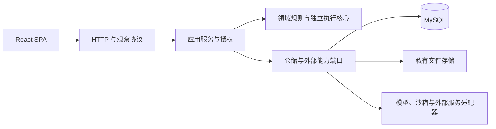

# 技术栈与架构

AntCDP 采用模块化单体：一个 Go 进程、一个 MySQL 数据库、一份应用持久化目录；React SPA 与 API 同源部署。当前保持单应用实例边界，不能仅凭共享数据库或独立数据卷推定支持多副本。

## 技术栈

| 层次 | 选择与职责 |
| --- | --- |
| 后端 | Go、Gin；入口与生命周期装配、HTTP 协议和应用服务分层 |
| 数据访问 | database/sql、go-sql-driver/mysql、sqlx；手写 SQL、显式事务和私有行映射 |
| 数据库 | MySQL、InnoDB、utf8mb4；结构与变更规则见[数据库约定](../database/README.md) |
| 结构与交付 | Goose、go:embed；二进制嵌入迁移和前端产物 |
| 前端 | React、TypeScript、Vite、React Router、TanStack Query |
| UI 与校验 | Tailwind CSS、Base UI、本地组件、TanStack Table、Lucide、Zod |
| 身份与秘密 | 数据库会话、HttpOnly Cookie、CSRF；bcrypt 密码哈希与独立主密钥加密 |
| 文件与日志 | 本地私有文件存储、小范围存储端口、log/slog |

版本以 [go.mod](../../go.mod)、[前端依赖声明](../../web/package.json)、锁文件和 CI 为准。sqlx 简化映射但不提供 SQL 生成期类型保证，结构、查询与事务必须由实库测试验证；Goose 显式管理结构，不使用 ORM 自动同步。

## 分层与源码导航

| 入口 | 职责 |
| --- | --- |
| [cmd/antcdp](../../cmd/antcdp)、[app](../../internal/app) | CLI、进程生命周期、依赖装配和维护循环 |
| [server](../../internal/server) | 路由、认证中间件、HTTP/WebSocket 协议与 SPA 服务 |
| [modules](../../internal/modules) | 平台身份、协作、集成等业务用例及授权；模块拥有各自模型和生命周期 |
| [store/mysql](../../internal/store/mysql)、[migrations](../../internal/store/migrations) | 仓储实现、事务适配、私有行结构、嵌入式 SQL |
| [platform](../../internal/platform) | 配置、密码、加密、受控网络、文件与协议基础设施 |
| [modelcore](../../internal/modelcore)、[modeladapters](../../internal/modeladapters) | 模型请求、原生消息和供应商协议适配 |
| [agentcore](../../internal/agentcore)、[agentadapters](../../internal/agentadapters) | 通用执行核心、小范围宿主端口、Eino/MCP 适配 |
| [agents](../../internal/modules/agents)、[agentresources](../../internal/modules/agentresources) | 平台授权、持久事实、执行编排、观察及资源管理 |
| [sandboxcore](../../internal/sandboxcore)、[sandboxadapters](../../internal/sandboxadapters)、[sandboxes](../../internal/modules/sandboxes) | 可替换的执行/文件接口及独立实例、租约、物理操作与恢复 |
| [cloudcomputers](../../internal/modules/cloudcomputers) | 使用基础沙箱实现持久工作空间与实例生命周期编排 |
| [webaccess](../../internal/webaccess)、[webaccessadapters](../../internal/webaccessadapters)、[skillpackage](../../internal/skillpackage) | 独立检索能力与适配、技能包校验 |
| [web/src](../../web/src)、[scripts](../../scripts) | 前端工程与构建、开发、验证入口 |

助手、模型、检索和沙箱核心不依赖 HTTP、平台身份或 SQL。宿主负责授权与持久化，适配器负责外部协议。基础沙箱也可供脚本使用，无需建立助手、会话或云电脑。云电脑使用基础沙箱提供持久工作空间，助手技能、轮次和成果的语义由助手适配层处理。

## 依赖与事务

服务通过用例所需的小范围端口协作。SQL、数据库句柄和驱动错误翻译留在仓储实现中；跨模块原子写入由用例组织共享事务，不通过服务互相调用而嵌套开启事务，也不建立依赖全部模块的全局仓储。

敏感写入在事务内重新检查身份、权限、状态和版本，并与必要审计共同提交。网络调用和大文件 IO 不持数据库锁；外部操作先记录意图，调用后再结算实际结果。事件与外部活动的一致性见[执行架构](agent-runtime.md)。

受控配置保存低频设置；业务身份、关系和生命周期属于领域模型。秘密使用专用加密存储，不能因配置字段标记为“敏感”就允许明文持久化。外部内容、工具描述和模型输出不能授予权限。

## 身份、存储与扩展

系统管理权限、资源业务角色、内容访问资格与执行身份分别校验。客户端可见性不构成授权，管理员身份也不自动赋予所有内容读取权限。密码哈希与可逆加密秘密分离；密钥派生及认证附加数据绑定安装、资源和用途，秘密不得进入普通响应和日志。

数据库、应用文件与沙箱工作空间分别管理生命周期。文件上传暂存、正式绑定和回收分开处理；实例删除不能代替卷删除，安装恢复也不能重新生成密钥来尝试解密旧数据。维护方法见[部署与恢复](../operations/deployment.md)。

扩展以实际用例为依据，不预建没有消费者的插件协议。模块独立不要求拆分进程或数据库。替换模型框架、存储或沙箱后端时，必须验证授权、并发、消息回放、取消和恢复语义；相同接口形状不代表行为等价。前端依赖方向见[前端规范](../development/frontend.md)。
