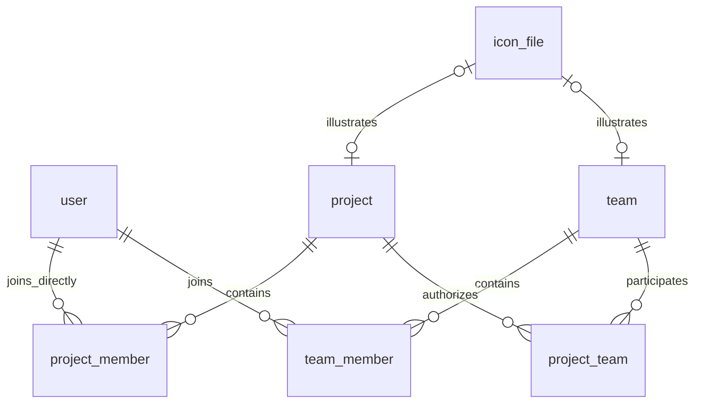

# 项目与团队设计

更新日期：2026-10-27。状态：基础业务接口、正式页面、图标和侧栏快捷方式已实现，完成真实 MySQL 与隔离部署验证；完整验收矩阵仍在推进。实测范围与限制见 [开发说明](development.md)。

后续细化见 [详细设计](projects-and-teams-detail.md) 和 [九表 DDL 阅读副本](projects-and-teams-schema.sql)。详细设计提供 API、并发、页面、权限及验收契约；第 8 节未确认项在详细设计中采用显式标注的默认值，不自动变为已确认需求。

本文是下一阶段项目与团队模块的设计入口。一期七张业务表及已发布迁移保持原有含义；本文不代表已经交付的能力。产品规则、工程建议及待确认项分别列出。

## 1. 已确认范围与规则

- 团队是可参与多个项目的成员组；项目独立存在，可添加个人及多个团队。
- 只有系统管理员可以创建项目、团队；创建时必须指定至少一位正常用户为业务管理员，可以选择创建者本人。
- 系统管理员可查看和管理全部项目、团队；其权限独立判断，不自动写入成员列表。普通用户只查看参与的项目、团队。
- 项目管理员和团队管理员可维护对应资料、成员及业务管理员角色；支持多管理员。团队管理员身份不会自动变成项目管理员。
- 团队加入项目只授予项目成员权限，项目管理员必须直接指定个人。团队成员增减自动影响团队来源的项目权限。
- 多种授权来源并存；移除一种来源不影响其他来源。直接项目管理员权限高于项目成员权限。
- 所有人都可退出，包括最后一位业务管理员；允许管理员全部降级或退出、允许成员人数为零。无人管理时由系统管理员重新指定；空项目、空团队不自动结束。
- 退出项目移除个人直接成员关系，团队继承关系需通过退出团队或撤销团队授权解除。
- 添加成员直接选择已有正常账号，不提供邀请确认、申请加入或公开项目。
- 项目管理员选择团队时，可搜索正常团队的名称、摘要和人数，不因此获得其成员名单的查看权限。
- 系统管理员可归档、恢复项目及解散团队。归档项目只读；团队解散撤销其带来的项目权限，保留历史。不提供项目永久删除。
- 禁用账号保留成员关系但立即失去访问能力，启用后恢复；删除账号移除成员关系并保留审计。不要求先交接最后一位管理员；既有创始人及系统账号自我操作保护仍有效。
- 归档项目的有效访问权限仍随团队成员变化、账号禁用和删除而变化。
- 项目、团队均包含唯一编码、唯一名称、纯文本摘要 `summary`、Markdown 简介 `description`。
- 图标支持内置 SVG 选择及 JPEG、PNG、WebP 图片上传和简单正方形裁剪，不支持上传 SVG。
- 编码字段名为 `code`，保留输入大小写，唯一性比较不区分大小写；允许大小写字母、数字、连字符和下划线。项目和团队各自建立唯一范围，跨类型允许相同编码及名称。
- 本阶段不包含任务、看板、仓库、迭代、工作流、自定义角色或 AI 执行。

## 2. 表结构总览（工程建议）

新增五张业务实体/关系表、一张图标文件表和三张用户侧栏偏好表，沿用单数 snake_case、InnoDB、BIGINT UNSIGNED 主键、UTC DATETIME(3)。API 中 ID 与版本仍使用十进制字符串。

| 表 | 职责 | 主键及唯一约束 |
| --- | --- | --- |
| `project` | 项目基础资料、归档状态 | 自增 `id`；`code`、`name` 分别唯一 |
| `team` | 团队基础资料、解散状态 | 自增 `id`；`code`、`name` 分别唯一 |
| `project_member` | 直接项目成员与角色 | `(project_id, user_id)` |
| `team_member` | 团队成员与角色 | `(team_id, user_id)` |
| `project_team` | 团队对项目的成员授权 | `(project_id, team_id)` |
| `icon_file` | 上传图标元数据、草稿及清理状态 | 自增 `id`；`storage_key` 唯一 |
| `user_sidebar_preference` | 用户两个快捷分组的并发版本 | `user_id` |
| `user_project_shortcut` | 项目固定及顺序 | `(user_id, project_id)` |
| `user_team_shortcut` | 团队固定及顺序 | `(user_id, team_id)` |

图中的两个文件关联不能单独表达“文件最多绑定一个项目或团队”；跨类型排他绑定由第 5 节的事务规则保证。

## 3. 项目与团队主表

两表各自保存以下字段，不建立通用实体表。长度为建议值，见待确认清单。

| 字段 | 建议类型/默认值 | 含义 |
| --- | --- | --- |
| `id` | BIGINT UNSIGNED，自增 | 稳定身份，所有业务外键使用 ID |
| `code` | VARCHAR(64)，ascii / ascii_general_ci | 保留大小写，大小写不敏感唯一索引 |
| `name` | VARCHAR(100) | 显示名称，单独唯一索引 |
| `summary` | VARCHAR(300)，空字符串 | 列表摘要，纯文本 |
| `description` | MEDIUMTEXT，非 NULL | Markdown 源文，创建时明确写入空字符串或内容 |
| `icon_key` | VARCHAR(64)，ASCII 二进制比较，可空 | 内置图标稳定 key |
| `icon_file_id` | BIGINT UNSIGNED，可空 | 外键关联上传图标 |
| `created_by_user_id` | BIGINT UNSIGNED，非空 | 创建者外键；不作为授权依据 |
| `row_version` | BIGINT UNSIGNED，默认 1 | 基础资料及生命周期版本 |
| `membership_version` | BIGINT UNSIGNED，默认 1 | 直接成员、角色、团队授权的集合版本 |
| `created_at` / `updated_at` | DATETIME(3) | 应用明确写入，无自动 ON UPDATE |

`project` 另含可空 `archived_at`；`team` 另含可空 `dissolved_at`。空值表示正常，非空表示归档或解散，不再维护重复的 status 字段。恢复项目清空 archived_at，历史由审计保存。

两表对 `icon_file_id` 分别建唯一索引，并建立文件外键；创建者关联 user 墓碑，外键使用 RESTRICT。CHECK 要求两种图标引用不能同时非空，版本至少为 1；没有指定图标时两列均为空，显示默认图标。

编码建议格式为 `^[A-Za-z0-9][A-Za-z0-9_-]{0,62}[A-Za-z0-9]$`。不通过小写转换改变用户输入；应用校验与数据库唯一约束共同工作，重复编码或名称返回 409。

名称比较语义仍属待确认项；详细设计及 DDL 阅读副本暂采用 utf8mb4_0900_as_ci，忽略大小写、保留重音差异。不能直接沿用 utf8mb4_0900_ai_ci 并解释为“只忽略大小写”，目标数据库仍需验证实际比较行为。

建议索引：项目 `(archived_at, created_at, id)`，团队 `(dissolved_at, created_at, id)`。不为简介建立全文索引，不存成员数量冗余列。

Markdown 只保存源文，不重复存储渲染 HTML；展示时统一安全渲染，禁用原始 HTML并校验链接协议。列表不返回简介全文。本阶段不因 Markdown 引入附件上传系统。

## 4. 成员关系与有效权限

`project_member` 和 `team_member` 均包含对象 ID、`user_id`、`role`、`created_at`、`updated_at`；role 使用 ASCII 字符串及 CHECK，仅允许 admin/member，不使用数据库 ENUM。project_team 仅含 project_id、team_id、created_at，不存固定的 member 角色。

外键关联对应主表及 user，使用 RESTRICT。反向索引分别为 `(user_id, project_id)`、`(user_id, team_id)` 和 `(team_id, project_id)`。添加关系必须检查用户正常且未删除、团队未解散、项目可写；添加既有关系不隐式修改角色。

有效项目成员来自直接关系与 `project_team → team_member` 的并集，按 user_id 去重；来源分别返回，不把团队成员复制进 project_member。只有直接关系的 admin 可提供业务管理权限。系统管理员使用独立授权分支。

禁用用户的关系仍存在，但授权查询始终检查账号状态；已解散团队不能提供授权。成员数应明确区分直接人数、团队数与去重后的有效用户数，避免把关联行数当成人数。

退出、移除及账号删除时删除相应关系行，历史写入 audit_event。解散团队时在同一事务内标记 dissolved_at、删除 team_member/project_team、递增受影响的成员集合版本并写审计；团队记录保留。再次加入视为新的加入时间。

零管理员、零成员均合法，不设置“最后一位管理员”数据库约束。创建时的至少一位管理员由创建事务验证。无管理员对象的普通成员无权自行提升身份。

## 5. 图标文件与裁剪

已确认单独建立 icon_file，复用 media 模块的文件接口、图像规范化和裁剪交互。现有 avatar_file 继续只表示用户头像，不在本阶段重命名。内容图片与缩略图后续独立设计，不扩展本表承担通用图片资源。

| 字段 | 建议类型 | 含义 |
| --- | --- | --- |
| `id` | BIGINT UNSIGNED | 主键 |
| `storage_key` | VARCHAR(120)，ASCII 二进制 | 服务端随机路径，唯一 |
| `content_type` | VARCHAR(32)，ASCII 二进制 | 固定 image/png |
| `width` / `height` | SMALLINT UNSIGNED | 统一 256×256 |
| `size_bytes` | INT UNSIGNED | 输出大小 |
| `sha256` | BINARY(32) | 完整性与 ETag，不做全局去重 |
| `uploaded_by_user_id` | BIGINT UNSIGNED | 用户外键，RESTRICT |
| `state` | VARCHAR(16)，ASCII 二进制 | staged/attached/orphaned |
| `expires_at` / `orphaned_at` | DATETIME(3)，可空 | 草稿过期及孤立时间 |
| `created_at` | DATETIME(3) | 上传时间 |

沿用头像建议限制：输入最大 2 MiB、边长最大 4096、总像素最多 16,777,216；服务端重新解码输出 256×256 PNG，最大 512 KiB。裁剪取消不上传，保存表单时才绑定；取消表单可删除草稿，否则 24 小时后过期。

CHECK 及索引沿用 avatar_file 的状态时间组合、图像规格和到期检索规则。内置 SVG 随应用发布，只有白名单 key 入库，不存任意 SVG、路径或远程 URL。

绑定事务锁定目标对象和图标文件，检查当前操作者权限、资料版本、草稿上传者和有效期；仅 staged 文件可绑定，原子变为 attached，且确认 project/team 均无现存引用。跨类型同时绑定同一草稿必须由同一文件行锁串行化。替换或移除后旧文件变 orphaned，不允许再次绑定。

草稿仅上传者可读；已绑定文件按对应项目/团队的可见权限读取。团队选择器需要图标时，仅提供其已授权的有限目录信息，不扩展为团队详情权限。清理时同时检查两张主表引用；不级联删除文件，磁盘失败回收遵循现有媒体清理模式。

## 6. 事务、版本与审计

资料、图标、归档/恢复使用 row_version；成员命令使用 membership_version。成员变化不使基础资料表单失效。团队成员变化不批量递增关联项目的版本：项目成员版本表示直接授权配置，不是完整有效成员快照，授权始终实时读取。

归档状态在任何项目修改事务中重查；不能仅凭成员版本判断可写。无变化的幂等操作不递增版本、不重复审计。

成员添加、退出、角色变动、解散及账号删除必须与权限重查、版本递增和审计原子提交。建议锁顺序为相关用户 ID 升序、相关团队 ID 升序、相关项目 ID 升序、文件 ID 升序；所有跨模块用例共同遵守。对可能变化的关联集合，在锁定其所属对象后重新发现并校验，不能依据事务外列表实施批量删除。

项目中团队撤权与旧成员写请求需在项目行锁上排序；团队成员退出、解散与旧团队授权请求需在团队行锁上排序。账号禁用/删除与成员写请求沿用 user 行锁重新授权。禁止读取事务外的旧权限后直接提交敏感修改。具体锁实现须通过并发测试验证。

沿用 audit_event，新增 project/team 的创建、资料修改、图标修改、成员添加/移除/退出、角色变更，以及项目团队授权/撤销、项目归档/恢复、团队解散事件。记录对象 ID、编码/名称快照及关系目标 ID；简介默认只记录发生变化及长度信息，不把大段 Markdown 或完整请求体写入审计。

系统审计仍只向系统管理员开放；本阶段不因业务管理员身份开放全站审计。项目或团队活动记录如需独立页面，另行确认范围。

## 7. API 与 UI 对接方向

### 工作区、控制台与快捷导航（已确认）

- 工作区面向日常协作，项目和团队列表只显示本人参与的对象；系统管理员也遵循这个默认范围。对应业务管理员可维护资料和成员，普通成员查看或退出。
- 控制台面向系统管理，只有系统管理员可进入，包含全部项目和团队（包括零成员、零管理员对象）。创建、项目归档/恢复和团队解散在控制台提供。
- 工作区账号菜单提供“进入控制台”，控制台顶部保留“返回工作区”；复用详情组件但保留各自导航和操作范围。
- 工作区侧栏包含首页、项目快捷分组、团队快捷分组和固定在底部的账号入口。分组标题只作标签，不跳转列表；每组加号表示固定已有对象，不表示创建。侧栏不显示“查看全部项目/团队”；用户菜单提供“项目”“团队”完整列表入口。
- 分组加号在桌面默认隐藏，鼠标经过标题行才显示；键盘焦点进入标题行时显示，触屏设备常显，保留可访问名称及占位，不造成布局跳动。
- 用户可固定、取消固定和调整快捷方式顺序；列表、详情也提供固定入口。快捷方式只影响导航，不提供权限或成员关系。
- 失去访问权限、退出后无剩余授权或团队解散时移除快捷方式；项目归档后保留并显示归档标识。侧栏中间区域可滚动。
- 正式产品按账号将固定与排序保存到数据库，跨设备一致，初始为空。新增两个快捷关系表和一个分组版本表；本地原型仍用浏览器存储演示，不能代表正式持久化实现。

### 接口与组件

项目、团队各为独立功能模块，沿用 Cookie/CSRF、字段错误、If-Match/412 和唯一冲突/409 契约。业务路由需允许有权限的普通用户访问，不将全部接口置于仅系统管理员可用的中间件之下；创建及生命周期命令单独校验系统管理员权限。

详情及成员响应说明个人直接角色和团队来源；退出直接成员关系前告知仍存的团队授权。无法管理时不展示可执行的管理入口。系统管理员能够检索零成员、零管理员对象并添加成员。

图标选择器提供默认、内置图标、上传裁剪；摘要与 Markdown 简介分开编辑。遵循现有双主题、字段错误、600ms 搜索及弹窗布局。具体 API 路径、请求 DTO、权限矩阵及页面布局已写入详细设计，仍待实施验收。

## 8. 尚待确认的产品细节

以下未作为已确认规则写入迁移，不阻碍先评审关系模型：

| 问题 | 建议 |
| --- | --- |
| 编码是否可修改、结束后能否复用 | 创建后不可修改；归档或解散后继续占用 |
| 编码长度与首尾 | 2–64 位，首尾为字母或数字 |
| 名称长度和比较 | 最多 100 个 Unicode 码点，去除首尾空白，英文大小写视为相同；重音差异保留 |
| 结束后的名称占用 | 归档或解散后仍占用名称 |
| 摘要和简介限制 | 选填，摘要最多 300 码点；Markdown 简介最多 100 KiB UTF-8 |
| 归档与自由退出交叉规则 | 归档项目允许本人退出，作为只读的例外；管理性成员调整需先恢复 |
| 团队解散是否可恢复 | 本阶段不提供恢复；保留墓碑和审计 |

## 9. 后续实施与验证

已补详细设计与独立 DDL 阅读副本；先确认待决产品细节，再通过新增 goose 迁移升级，不修改已发布的初始迁移。已有用户头像数据不需迁移。建立 project/team 模块及跨模块事务端口，不使用 settings KV 承载实体。

重点验证编码大小写冲突、名称唯一性、直接与多个团队授权的去重/撤销、最后管理员退出、空对象接管、禁用与删除用户、归档只读及退出例外、团队解散与写入竞争、跨类型图标重复绑定、草稿清理、权限变化后的旧请求以及资料/成员版本冲突。

本稿描述完整目标；迁移和侧栏后端已进行 MySQL 8.0 及隔离容器验证，其他并发和浏览器业务验收仍待完成，详见开发说明。
