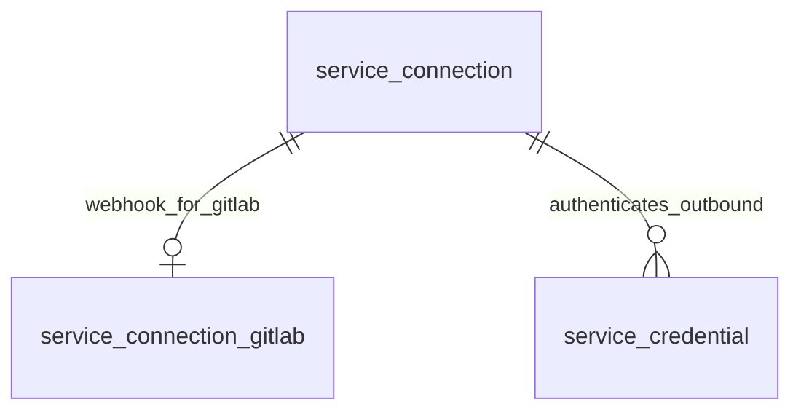

# 外部服务集成设计

更新日期：2026-10-29。本文是重新设计后的目标契约，取代旧 `integration / integration_gitlab / integration_credential` 三表方案，不要求本模块旧表、旧 API、旧标识和旧接收地址兼容。GitLab、Jenkins、OpenObserve、Elasticsearch、MySQL 与 PostgreSQL 管理 API 和正式页面已实现；迁移 5 保留已合并的 GitLab 结构，最终迁移 6 将 GitLab 地址及 CA 搬入连接 config JSON，保留版本 5 的数据及密文，不创建 Jenkins 表。旧集成的历史重建规则仅适用于迁移 5，实际交付状态见[开发说明](development.md)。

## 1. 目标与范围

服务集成使 Agent 和平台能够访问外部系统、执行操作、读取信息及接收外部事件。

| 用例 | 服务能力 | 配置与本次操作的边界 |
| --- | --- | --- |
| 开始需求开发 | GitLab 创建 feature 分支 | 连接保存基础地址；仓库、分支由操作输入提供 |
| 完成开发 | GitLab 合并、Jenkins 构建部署 | MR、Job、构建参数属于操作输入 |
| 排查 BUG | MySQL 查询、OpenObserve / Elasticsearch 检索 | 连接保存地址和默认上下文；查询、索引、时间范围由操作提供 |
| 接收代码平台事件 | GitLab Webhook | 连接内的 Webhook 设置管理验证、接收和诊断；事件筛选与项目绑定属于消费方 |

本次不设计工作流节点、触发规则、执行图、运行记录、可靠分发和运行时凭证选择链。不开放任意 HTTP 代理、SQL 查询或 Agent 执行 API。GitLab、Jenkins、OpenObserve、Elasticsearch、MySQL、PostgreSQL 支持连接及凭证维护、连接测试和凭证验证；未实现的适配器不注册可创建类型，不预建空表。

### 通知模块边界

钉钉机器人发送通知移出本模块，后续与邮件、短信统一在独立通知模块设计。钉钉自定义机器人的认证材料可能同时决定机器人/群目标，不能强行要求“连接先确定机器人，凭证只更换身份”。通知模块应围绕渠道配置、接收目标、消息内容和投递结果建模，允许不同渠道的目标与认证材料存在不同耦合关系；不要求所有渠道共用一套连接/凭证关系。

本轮不建立通知表、不定义发送 API、模板、重试或路由策略；现有“一期没有邮箱/SMTP/邮件通知”规则不变。后续通知模块可以复用加密、受控网络访问和审计基础设施，但不强制引用 service_connection / service_credential。钉钉的出站机器人 URL 即使被称为 Webhook，也不是 AntCDP 的入站 Webhook 接收设置。

## 2. 统一术语与关系

| 中文 | 领域名 | 定义 |
| --- | --- | --- |
| 服务集成 | integrations 模块 | 模块名称，不再作为一条配置记录的实体名 |
| 服务类型 | ServiceType | gitlab、jenkins、mysql、openobserve、elasticsearch 等代码标识 |
| 服务适配器 | ServiceAdapter | 代码实现，定义配置、认证、验证、操作和事件能力 |
| 服务连接 | ServiceConnection | 具名、可稳定引用的访问目标及配置，不是运行中的网络连接 |
| 访问凭证 | ServiceCredential | 属于一条连接的认证方式、外部身份和加密秘密 |
| 凭证归属 | CredentialOwnership | system / project / personal；表示归属，不代表远端权限范围 |
| Webhook 接收设置 | WebhookSettings | 连接的一份入站验证、启停和诊断设置，无独立实体身份 |
| 首选凭证 | preferred credential | 同连接、同归属内优先采用的一份凭证 |
| 兜底凭证 | fallback credential | 连接显式指定的一份系统凭证，表达缺失时回退的意图 |

从所有类型看扩展关系为 0..1；类型为 gitlab 时必须恰好一条 Webhook 扩展，jenkins 不使用扩展表。类型与适配器是代码注册项，不建表。关系均为逻辑关联。同一实际部署可建立多条连接，例如相同 MySQL 主机的不同默认数据库，地址不唯一。凭证不能改变连接的访问地址。

## 3. 配置、认证与执行边界

| 服务类型 | 连接配置示例 | 凭证身份 / 秘密示例 | 操作参数示例 |
| --- | --- | --- | --- |
| gitlab | 基础 URL、公共 CA | identity={} / Access Token | 仓库、分支、MR ID |
| jenkins | 基础 URL、公共 CA | 用户名 / API Token | Job、构建参数 |
| mysql | 主机、端口、默认数据库、TLS | 用户名 / 密码或客户端私钥 | 查询、绑定参数 |
| openobserve | 地址、默认组织（默认 default）、公共 CA | 用户名 / 密码或服务账号 Token（Basic） | 日志流、时间范围、条件 |
| elasticsearch | 单个 API 入口、公共 CA | 用户名 / 密码，或完整 encoded API Key | 索引、检索条件 |

后续服务的认证组合仅为建模示例，确切协议、DTO 和验证应随适配器设计。RabbitMQ、Redis、PostgreSQL、MongoDB、Nacos 同样按实际需求扩展。默认数据库、组织等不是授权范围；凭证维护权、未来凭证使用权与执行合并/部署/查询的业务授权分开，执行模块须在解密和远端调用前完成业务授权。

采用代码注册和类型化结构，拒绝未知字段、认证方式和结构版本。连接表保存公共管理字段和类型化 config JSON；配置由 service_type 与 config_schema_version 决定，节点列表可用受控 JSON 数组。identity_config 及加密 secret 由 service_type + auth_method 定义，不提供自由 JSON 编辑器、任意请求头或运行时插件加载。带秘密的 DSN、userinfo、query 和 URI 不能进入普通配置，也不能进入日志、诊断或审计。

适配器可声明 gitlab.create_branch、gitlab.merge_merge_request、jenkins.trigger_build、mysql.query、openobserve.search_logs、elasticsearch.search 等能力。这些名称不是已经实现的操作，本次不建立 tool/operation 表、不提供执行 HTTP API。外部 MySQL 服务适配器与 AntCDP 自身 MySQL 仓储适配器职责独立。

## 4. 数据库结构

完整 DDL 见 [schema.sql](schema.sql)。本模块包含连接、凭证两张公共表及 GitLab Webhook 扩展，共三张表；加上一期七张和协作九张，共 19 张目标业务表。新增服务优先使用类型化 config JSON，仅在需要独立生命周期、查询或约束时增加业务表。不设凭证集合表、一对一秘密表、事件收件箱或工作流表。

采用 BIGINT UNSIGNED ID、UTC DATETIME(3)、单数 snake_case。三表不设置物理外键或 CHECK；保留主键、唯一键、索引、类型、可空性和默认值。所有写入口在事务内验证关联、布尔、正版本号、归属组合、JSON 和秘密封装，不能依靠生成列兜底非法归属。既有十六张表的物理外键与 CHECK 也由迁移 5 移除；关联和状态规则通过应用校验、锁与事务保证。

### 4.1 service_connection

| 字段 | 职责 |
| --- | --- |
| id、service_type、code | 稳定身份、不可变类型、不可变程序标识 |
| name、description、enabled | 公共资料和整条连接的管理开关 |
| config | 非空 JSON 对象，按服务类型校验的出站配置，不含秘密 |
| config_schema_version | 配置结构版本，当前为 1，与编辑/诊断失效版本独立 |
| fallback_credential_id | 可空，同连接系统凭证的逻辑引用 |
| row_version | 公共资料及服务配置共用的聚合编辑版本 |
| config_version | 影响出站访问的配置版本，地址/CA 等变化时递增 |
| credentials_version | 凭证子集合内部版本，不直接暴露计数值 |
| fallback_version | 兜底设置独立版本 |
| last_connection_check | 受控 JSON 诊断，可空，不属于编辑表示 |
| created_by_user_id、created_at、updated_at | 创建溯源；updated_at 仅随连接编辑变化 |

UNIQUE(code) 全局唯一；UNIQUE(service_type,name) 同类型名称唯一。code 匹配 `[a-z0-9][a-z0-9_-]{0,63}`，创建可省略或空白，由服务端生成去短横线 UUID v4，之后不可修改。名称去首尾空白，1–100 字符，大小写不敏感、重音敏感；说明不超过 1000 字符。

兜底只能指向同连接中已启用、材料完整且未已知过期的系统凭证。未验证不妨碍保存。首选/兜底均须显式设置，不自动取第一份；认证失败、权限不足、过期或引用损坏不能当作“缺失”而触发回退。本轮不实现实际选择链。

### 4.2 service_connection_gitlab

connection_id 为主键，逻辑引用 service_connection.id。此表仅保存 Webhook 开关、验证方式、加密秘密、独立 webhook_version、最近接收诊断与更新时间（见 4.4）。每条 GitLab 连接固定一行，即使尚未启用 Webhook。与主表同事务创建和删除；缺失或类型错配返回受控完整性错误，不当作未配置。地址/CA 编辑更新主表 config，Webhook 编辑仅更新扩展中的 webhook_* 列，互不覆盖。

### 类型化连接配置

GitLab 与 Jenkins 当前均采用 `config={base_url,custom_ca_pem}`：base_url 必填、最长 2048 字符，custom_ca_pem 可空、最多 16 KiB、不接收私钥。支持 HTTP、HTTPS、端口及部署子路径，禁止 userinfo/query/fragment，HTTPS 严格校验证书，不提供跳过 TLS 开关；API 路径由适配器构造。

持久化读写均按注册适配器解码与校验；未知字段、非对象、无效配置或不支持的结构版本返回受控完整性错误。API 保持类型化 DTO，不开放自由 JSON 编辑。config_schema_version 当前为 1，结构演进时显式迁移；row_version 控制连接编辑并发，config_version 控制出站诊断失效，三者职责独立。Token 等秘密继续在凭证表加密保存，不进入 config。

Jenkins 使用 `jenkins_api_token`，`identity_config={username}`、`secret={token}`。用户名为非秘密登录名，必填、最多 255 UTF-8 字节，禁止首尾空白、冒号及控制字符；拒绝未知字段。Token 与 GitLab 一样加密保存，独立认证替换完整提交用户名和 Token。加密用途按服务类型绑定，既有 GitLab 用途字符串保持不变。

### 4.3 service_credential

| 字段 | 职责 |
| --- | --- |
| id、connection_id、service_type、code | 稳定标识，service_type 从连接派生 |
| ownership_type、project_id、user_id | system / project / personal 及归属主体 |
| owner_key | 生成列：system 为 0，否则为对应项目或用户 ID |
| name、description | 凭证资料 |
| auth_method、auth_schema_version、identity_config | 认证方式、结构版本和非秘密身份信息 |
| secret_ciphertext、secret_format_version、secret_key_version | 同记录内的加密秘密封装 |
| enabled、is_preferred、preferred_slot | 启停、首选；preferred_slot 为 1 或 NULL 的生成列 |
| expires_at | 可空人工维护的有效期时间点 |
| row_version、material_version | 编辑版本、认证身份/秘密材料版本 |
| last_verification | 可空验证摘要，不属于编辑/集合表示 |
| created_by_user_id、created_at、updated_at | 溯源与编辑时间；创建者不等于所有者 |

system 的主体 ID 全空；project 仅 project_id 有值；personal 仅 user_id 有值。连接、类型、归属和 code 创建后不变。code 格式/生成规则同连接，保留同服务类型跨连接与归属唯一的定位语义。

唯一约束：

- (service_type,code)：冲突不暴露其他归属资料。
- (connection_id,ownership_type,owner_key,name)：同归属名称唯一。
- (connection_id,ownership_type,owner_key,preferred_slot)：同归属最多一份首选；NULL 允许多份非首选。

首选要求已启用、材料完整且未已知过期。自然过期实时判断，保留既有首选/兜底并告警，不后台重选；停用或删除原子清除标记/引用，重新启用不恢复。

GitLab auth_method=gitlab_access_token，identity_config={}，secret={token}，不维护 token_type 或猜测身份。普通编辑不能写认证材料；独立认证替换命令完整提交 auth_method、identity_config、secret，原子更换方式、身份和秘密。秘密三字段必须完整；仅适配器显式支持无秘密方式时允许三字段同时为空。GitLab Token 必填。

### 4.4 连接内的 Webhook 接收设置

WebhookSettings 是连接的一份设置值，不是独立实体，没有接入点表、独立 ID、code、名称、说明、创建和删除命令。GitLab 接收设置存于 service_connection_gitlab，与该连接同时创建和删除；不支持 Webhook 的其他服务无需预留相同字段。

| 字段 | 职责 |
| --- | --- |
| webhook_enabled | 接收开关，初始 false；启用前必须已有合法秘密 |
| webhook_verification_method | secret_token / signing_token，初始 secret_token |
| webhook_secret_ciphertext、webhook_secret_format_version、webhook_secret_key_version | 此连接的加密入站秘密，初始全部 NULL |
| webhook_version | 独立编辑版本，初始 1；启停或替换方式/秘密时递增 |
| webhook_last_receipt | 可空最近已认证接收摘要，不是事件队列 |
| webhook_updated_at | 可空最近设置修改时间，初始 NULL；接收诊断不改变它 |

每条连接固定一个接收地址和一份验证秘密。多个远端 Hook 使用该连接的同一地址和秘密，轮换后均需同步修改。访问凭证与入站秘密用途独立，禁止复用首选或兜底凭证。

不包含事件白名单、外部项目 ID 或项目绑定配置。通过认证且格式合法的 GitLab 事件均可接收，包括没有 project 字段的事件。事件筛选、外部项目选择和 AntCDP 项目关联由消费方配置；本轮不实现消费规则、工作流或可靠分发。

## 5. 权限与生命周期

| 能力 | 权限 |
| --- | --- |
| 连接、系统凭证、兜底、Webhook 接收设置 | 系统管理员 |
| 项目凭证及首选 | 对应项目管理员、系统管理员 |
| 个人凭证及首选 | 本人，系统管理员不能代管他人 |
| 类型与有限连接目录 | 正常登录用户，仅公开能力和连接 ID/code/类型/名称/说明/启停 |
| 外部验证 | 对应维护权限，归档项目不可验证 |
| 保存后秘密读取/复制/导出 | 不提供接口 |
| Webhook 接收 | 不使用登录会话，按连接的 Webhook 配置认证 |

不设团队凭证；普通项目成员无凭证管理权，团队管理员不自动取得项目权限。系统凭证可供完成自身业务授权的平台代执行，不要求授权给当前操作人；这不等于开放通用凭证执行接口。

连接停用禁止连接测试、凭证验证和入站接收，仍可维护配置；保留凭证和 Webhook 接收开关。恢复连接后原已启用的能力恢复可用。单独关闭 Webhook 不影响出站。删除连接要求所有归属凭证已清空；连接内的 Webhook 设置、秘密和摘要随连接配置一并删除，接收地址失效，远端 Hook 需自行移除。

项目归档后凭证只读，恢复后可维护。用户禁用保留个人凭证，账号逻辑删除与个人凭证清理同事务；系统/项目凭证保留创建者墓碑引用。未来项目硬删除须复用相同清理协议。ID 不复用，code 可在原记录删除后重新使用；后续执行授权须绑定资源 ID，不能因 code 被复用而继承授权。

## 6. 事务、版本和加密

### 6.1 锁与版本

先按既有用户→团队→项目授权锁协议取得相关锁，再按 ID 升序锁 service_connection，最后按凭证 ID 顺序锁需要的子记录；连接配置及 Webhook 设置读写均先锁父连接。事务中重新校验权限、归属、状态、版本和关联，同事务保存审计。外部网络等待不持数据库锁。

账号删除先锁用户，再发现并排序锁相关连接和个人凭证；创建个人凭证同样先锁用户。连接锁串行化子对象维护与父删除，避免检查时不存在子对象、提交时出现孤儿。

| 操作 | 必须递增的版本 |
| --- | --- |
| 修改连接资料/启停 | connection.row_version |
| 修改出站配置 | connection.row_version、config_version |
| 新增/删除/编辑凭证 | credentials_version；存在的修改记录 row_version；认证变更另增 material_version |
| 切换/清除首选 | credentials_version、所有标记改变的凭证 row_version |
| 设置/清除兜底，包括停用/删除时清除 | fallback_version |
| 修改 Webhook 启停或替换验证秘密/方式 | service_connection_gitlab.webhook_version；不改变连接 row_version/config_version |
| 保存诊断 | 不改变编辑/集合版本、updated_at |

凭证 is_preferred 属于编辑表示，变更同时更新该记录 updated_at。连接表示不含兜底或子集合状态。诊断从编辑 DTO 和集合中完全拆出；集合不返回依赖当前时间的 usable/outdated 字段，过期提示由客户端按 expires_at 计算，写入资格由服务端实时检查。

无变化不增版本、不重复审计。连接公共资料/配置采用同一聚合 ETag，可一次 PATCH 原子保存。Webhook 设置与兜底各有独立资源版本，无 Webhook 集合版本。credentials_version 按连接维护，其他归属的变化可能令旧集合请求收到 412，是不建归属集合状态表的明确取舍。

### 6.2 诊断快照

连接测试绑定 connection.row_version/config_version；凭证验证另绑定 credential.row_version/material_version；入站接收绑定 connection.row_version、service_connection_gitlab.webhook_version。网络调用前取快照，提交时重查权限、状态和版本；发生改变返回 409 STATE_CHANGED 并丢弃结果，失去权限按权限错误响应，不返回身份详情。父连接停用再启用也使旧结果失效。

诊断包含服务端 started_at/received_at、finished_at、诊断 ID、快照版本、结构化结果及白名单摘要。同版本并发回写只保留开始时间较新的结果，相同时间以随机诊断 ID 确定稳定次序。GET diagnostics 按当前版本计算 outdated；名称等非访问字段修改也可保守地使结果过时，不宣称诊断等于实时健康。

连接测试不暗用首选/兜底；凭证验证仅使用指定已保存凭证。网络可达、认证有效和具体业务权限分别表达。允许未验证或验证失败的配置保存。

### 6.3 秘密

沿用主密钥、独立用途派生、AES-256-GCM 和随机 nonce。凭证和 Webhook 设置分别使用独立用途；AAD 绑定安装 ID、资源种类/ID、connection_id、服务类型和认证/验证结构版本。先取得记录 ID，同事务完成加密，临时占位不可提交。普通查询显式选择非秘密列，不将 SELECT * 映射到 DTO。

只有内部受控调用解密。秘密替换要求完整结构，不用省略、null 或星号占位隐式保留旧值。生成入站传统 Token 可一次性返回明文，响应丢失需重新生成，保存后没有读取接口。不承诺双密钥过渡、自动轮换或备份擦除，恢复依赖原主密钥。

## 7. GitLab 接收契约

Webhook 设置显式选择 secret_token 或 signing_token，禁止按请求自动切换或失败降级。传统模式常量时间比较 X-Gitlab-Token；签名模式按 [GitLab 官方 Signing Token 规则](https://docs.gitlab.com/user/project/integrations/webhooks/#signing-tokens)验证原始请求体及签名头，支持多个候选，限制 ±5 分钟时间窗；具体 GitLab 部署必须支持所选模式。

创建连接时 Webhook 固定 disabled、默认 secret_token 且无秘密。启用必须已有匹配的合法秘密；PUT verification 一起替换方式和秘密；生成/导入不隐式启用。已启用时替换立即生效，仅影响该连接，需同步更新所有使用该接收地址的远端 Hook。

接收地址 `/api/v1/webhooks/gitlab/{connection_id}` 从可信部署访问地址生成，不取任意 Host 头；ID 不是认证手段。本轮不自动管理 GitLab 端 Hook。

接收顺序：

1. 限流，限制 POST/application/json 和 1 MiB 请求体；检查连接与 Webhook 接收均启用。
2. 按已保存配置验证原始请求；失败 401，不污染接收诊断。
3. 要求恰好一个非空 X-Gitlab-Event 头（最长 128 字节）和 JSON 对象请求体，不限制事件枚举，不要求 project 或其他业务字段。
4. 短事务重查父/子状态、版本及连接扩展完整性，保存诊断；竞争变化拒绝旧结果。
5. 接受事件返回 200 received_not_dispatched，表示已验证接收，未入队、未执行工作流。接收端不按事件类型或项目 ID 过滤。

不存在、类型不符或已停用 404；格式错误 400、过大 413、媒体类型错误 415、限流 429、状态竞争 409、暂时无法持久化 503。扩展缺失返回受控完整性错误，不冒充 404。未认证或结构无效请求不覆盖最近已认证且可解析事件摘要。

诊断仅保存接收时间、投递标识、原始事件头值、可选外部项目 ID、状态及版本，不保存完整 payload、提交内容、人员信息或认证头。重复投递可重复更新摘要；签名时间窗不等于可靠去重。后续可靠处理需要另行设计事件收件箱与分发，本三表不承担这些职责。

## 8. 网络、审计与验收

GitLab 对外支持 HTTP 和 HTTPS；HTTPS 严格校验证书和主机名；允许受控业务私网，拒绝回环、未指定、链路本地和云元数据地址。校验 DNS 全部地址并按已验证地址拨号，不使用环境代理、不跟随重定向。总超时 10 秒、响应上限 1 MiB、验证全局并发上限 8，另设入口限流。后续数据库协议须单独定义端口/TLS/网络策略。

审计动作：service_connection.created/updated/deleted/fallback_changed，service_credential.created/updated/authentication_replaced/deleted/preferred_changed，service_connection.webhook_updated/webhook_verification_replaced。启停纳入 updated 并记布尔变化。只保存白名单元信息，不记录秘密、认证身份材料、内部地址或请求全文；个人凭证审计也不得泄漏身份信息。高频接收和诊断不逐条写业务审计。

实施验收覆盖：

- 三表唯一约束、类型扩展完整性、非法归属/JSON/秘密拒绝和跨归属隔离。
- 聚合原子 PATCH、独立子资源版本、首选变更更新新旧凭证版本、兜底清理及并发 412。
- 父删除与子新增、账号清理与凭证新增、撤权/归档与维护竞争。
- 两条连接的 Webhook 独立启停/轮换、任意事件类型及有无项目字段均可接收、父停用和在途请求、错误模式不降级。
- 网络/TLS、资源绑定加密、无锁外部验证、过时结果拒绝、保存后无秘密读取。
- 页面区分连接/凭证/Webhook 设置、首选/兜底，明确未分发工作流，通知模块不混入服务类型目录。

新装、升级及 HTTP 生命周期的实际验证范围与限制见开发说明。详细 HTTP 契约见[服务集成 API](service-integrations-api.md)。关联规则见[领域模型](domain-model.md)、[数据库](database.md)、[架构](architecture.md)、[扩展性](extensibility.md)及[UI 规范](ui-design.md)。

## Jenkins 验证与能力边界

连接测试无认证 GET `{base_url}/whoAmI/api/json`；凭证验证主动发送 HTTP Basic（用户名 + API Token），只请求同一个只读身份接口。检查成功状态、JSON 媒体类型及 name/authenticated/anonymous 字段。认证成功要求 authenticated=true、anonymous=false，且远端 name 与配置用户名一致；不同身份返回 identity_mismatch，不信任代理自动登录为其他用户。

诊断分别表达 HTTP 可达、识别 Jenkins API、认证结果，具体 Job 构建权限保持 unknown。401 表示认证失败；403 表示访问被拒绝，认证结论保持 unknown；重定向不跟随，代理页和不完整 JSON 不判为成功。响应最多 1 MiB，沿用超时、并发、DNS/IP 与 TLS 限制，只保存白名单摘要。人工 expires_at 不等于远端 Token 到期信息。

本次不支持密码认证、crumb 配置、Job 默认值、构建操作或入站回调。operations 为空，webhook.supported=false。未来执行模块负责 Job、参数、授权及队列/构建跟踪；不得以触发构建作为凭证验证。

## OpenObserve / Elasticsearch 兼容范围

OpenObserve 以开源版当前稳定版本为目标，2026-10-29 官方发布页最新稳定版为 v1.1.2。Elasticsearch 以 7.17.x、8.x、9.x 为验证基线，使用通用 HTTP API，尽量兼容更早 7.x，不承诺所有历史次版本。实际验证范围见开发说明。

OpenObserve 连接的 default_organization 默认 default、可编辑；未来操作显式组织优先，否则使用连接默认值。默认上下文不授予权限，访问失败不回退。凭证属于连接而非某个组织。无认证 Elasticsearch 无需创建凭证；只做连接探测，不将匿名响应认定为已保存凭证有效。两种服务均不含检索、Webhook 或执行能力，准确配置与探测协议见[API 契约](service-integrations-api.md#openobserve-与-elasticsearch-管理契约)。

## MySQL / PostgreSQL 连接（2026-10-30）

两种数据库复用连接 config JSON 与加密凭证，不新增表或迁移。类型分别为 `mysql`、`postgresql`。连接分别保存主机、端口和必填默认数据库，身份与密码单独保存在凭证中。TLS 默认 `disable`；可选择 `verify-full` 校验证书及主机名，支持自定义公共 CA，不支持跳过证书校验或自动降级。旧 URL 配置读取时自动拆分，保留原 TLS 选择。

连接测试仅建立 TCP 连接，证明端口可达，不识别数据库服务或验证 TLS。凭证验证使用原生驱动连接指定数据库并执行固定 `SELECT 1`，不读取业务表、不执行写操作、不开放任意 SQL API。成功表示该账号能够访问目标数据库，业务权限仍为 unknown。PostgreSQL 要求密码认证（password / MD5 / SCRAM），不把 trust 连接当作密码验证成功。

沿用受控 DNS 与 IP 检查，支持私网，禁止回环、链路本地、元数据及特殊地址；解析后直接拨号到已校验 IP。诊断整体超时 10 秒，复用 8 个出站并发槽；错误仅保存白名单原因，不保存驱动错误原文或密码。数据库协议错误分别归类认证失败、访问拒绝、数据库不存在，网络失败沿用现有分类。
